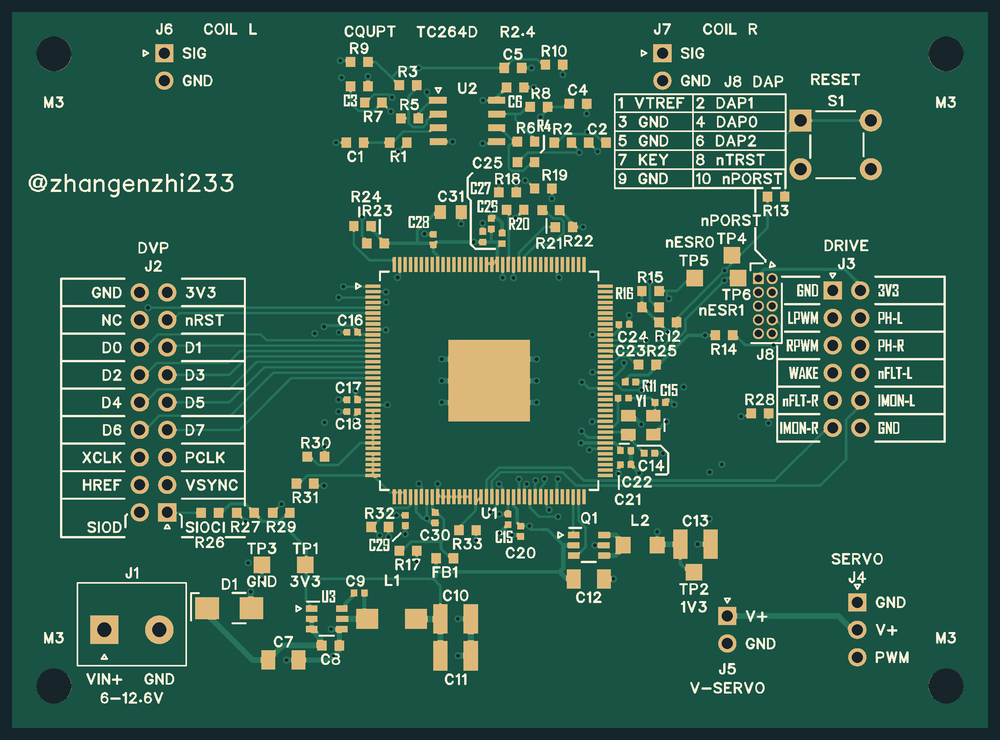
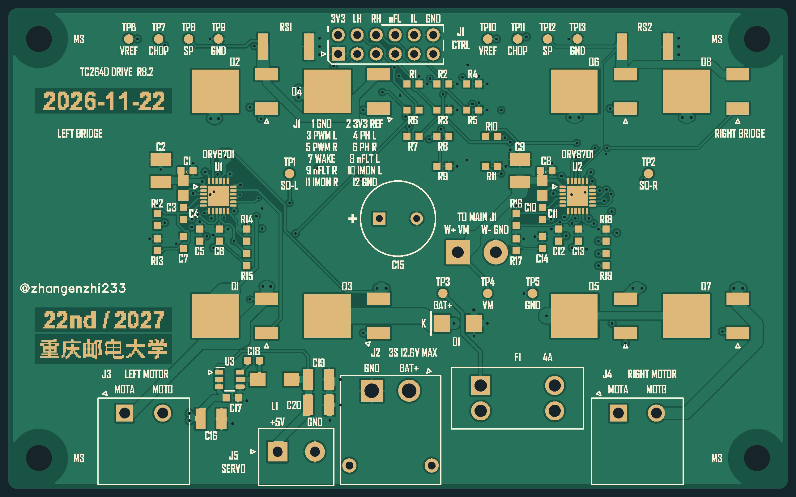
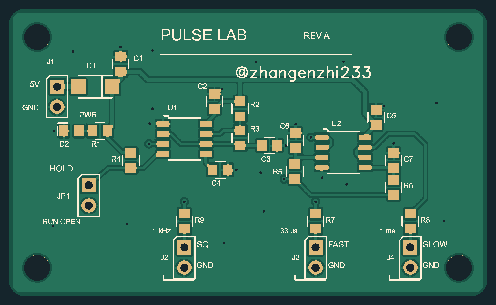

# 嘉立创 EDA 专业版 PCB 绘制与验收

一个可以在 Codex 中调用的中文技能。它从原理图和引脚表开始，检查布局、走线和回流，整理元件位号和排针丝印，最后用实际导出的网表与 Gerber 核对成品。适用于双层板、四层板和六层板。

## 安装与使用

[下载技能 ZIP](dist/easyeda-pcb-workflow.zip)，将其中的 `easyeda-pcb-workflow` 整个文件夹放入用户目录的 `.codex/skills/`，打开新的 Codex 会话即可。要在一个项目内使用，也可放入该项目的 `.agents/skills/`。技能入口是 [SKILL.md](skills/easyeda-pcb-workflow/SKILL.md)。

例如，可以在工程所在目录发出这条请求。

> 用 $easyeda-pcb-workflow 从我圈出的拐点开始复查整块板，先检查同层折返、冗余地线和双排接口丝印，再说明最终制造文件中核实了哪些项目。

审查时可以直接查阅[走线与接地](skills/easyeda-pcb-workflow/references/routing-review.md)、[元件和接口丝印](skills/easyeda-pcb-workflow/references/silkscreen.md)及[验收方法和三个只读脚本的用法](skills/easyeda-pcb-workflow/references/verification.md)。[参考项目与课程](skills/easyeda-pcb-workflow/references/sources.md)列出了上游项目和课程分集。

## 可编辑样例

在嘉立创 EDA 专业版中导入对应的 `.epro2` 文件，即可查看原理图和 PCB。在 PCB 的**顶层丝印层**可以选中并编辑 `@zhangenzhi233`。三张预览均由对应署名工程导出的制板图层绘制。

| TC264D 主控板 R2.4 | 双路电机驱动板 R8.2 | PulseLab‑A 测试板 |
| --- | --- | --- |
|  |  |  |
| 四层。可沿主控检查去耦、时钟、下载口，以及双排接口的逐针标识。 | 四层。可对照左右两个电桥，检查功率通路、分流取样和端子标识。 | 双层。可从方波发生器追踪到快慢两路滤波与缓冲输出，练习原理图和板图互查。 |
| [下载主控板工程](examples/tc264d-main-r2.4/tc264d-main-r2.4.epro2) | [下载驱动板工程](examples/motor-driver-r8.2/motor-driver-r8.2.epro2) | [下载测试板工程](examples/pulselab-a/pulselab-a.epro2) |

在嘉立创 EDA 专业版 4.1.93 复开三份设计后，原理图 ERC 和 PCB DRC 均为 0。主控、驱动、测试板分别核对了 311、201、62 个已分配网络的引脚。导出的顶层丝印都包含署名，署名距阻焊开窗最近分别为 7.733、1.781、2.231 mm。电机驱动的温升、主控起振和整机带载等性能仍需在实板上测量。

